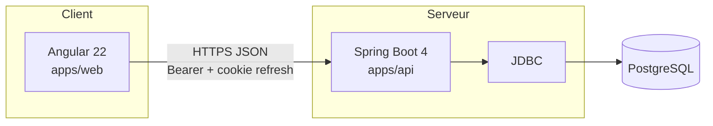

# PIF MarketLab — Simulateur intelligent de salle de marché

**Nom produit (anglais) :** Market Trading Room  
**Interface utilisateur :** français  
**Stack active :** Angular · Spring Boot · PostgreSQL

PIF MarketLab est une plateforme pédagogique de simulation financière. Elle permet de s’entraîner au trading virtuel, de gérer des portefeuilles fictifs, de suivre des missions MarketQuest, de revisiter des décisions avec la Financial Time Machine, de parcourir des FinStories et d’expérimenter des modèles actuariels non-vie — **sans argent réel ni données de marché live**.

---

## Table des matières

1. [Présentation](#1-présentation)
2. [Contexte et problématique](#2-contexte-et-problématique)
3. [Objectifs du projet](#3-objectifs-du-projet)
4. [Fonctionnalités principales](#4-fonctionnalités-principales)
5. [Trading et portefeuilles](#5-trading-et-gestion-des-portefeuilles)
6. [MarketQuest](#6-marketquest)
7. [Financial Time Machine](#7-financial-time-machine)
8. [FinStories](#8-finstories)
9. [Laboratoire actuariel](#9-laboratoire-actuariel)
10. [Architecture technique](#10-architecture-technique)
11. [Organisation du dépôt](#11-organisation-du-dépôt)
12. [Prérequis](#12-prérequis)
13. [Installation et configuration](#13-installation-et-configuration)
14. [Variables d’environnement](#14-variables-denvironnement)
15. [Démarrage](#15-démarrage-de-lapplication)
16. [Tests et qualité](#16-tests-et-qualité)
17. [Sécurité](#17-sécurité)
18. [Modèles financiers et actuariels](#18-modèles-financiers-et-actuariels)
19. [État d’avancement](#19-état-davancement)
20. [Perspectives](#20-perspectives)
21. [Références](#21-références)

---

## 1. Présentation

PIF MarketLab (Market Trading Room) est le **simulateur de salle de marché** du projet académique PIF (année universitaire 2026–2027). L’application offre un espace de travail unique où un compte authentifié accède à :

- des **marchés simulés** (univers d’instruments fictifs en dinars tunisiens) ;
- une **salle des marchés** pour passer des ordres virtuels ;
- des **portefeuilles** multi-positions avec valorisation et risque ;
- un parcours d’apprentissage **MarketQuest** (dix missions jouables) ;
- la **Financial Time Machine** (rejeu contrôlé des décisions) ;
- des **FinStories** (récits courts de décision financière) ;
- un **laboratoire actuariel** (tarification, Monte Carlo, provisionnement).

Le frontend Angular et l’API Spring Boot partagent la même base PostgreSQL. Aucun runtime NestJS, Next.js, React ou Prisma Client n’est requis pour faire tourner l’application.

---

## 2. Contexte et problématique

L’apprentissage de la finance de marché et de la gestion des risques est difficile sans environnement d’entraînement sûr. Les plateformes de courtage réel exposent à des pertes ; les supports purement théoriques ne permettent pas de vivre la séquence décision → exécution → conséquence.

PIF MarketLab répond à ce besoin en proposant :

- une **simulation déterministe** (même entrée → même sortie) pour la pédagogie et les tests ;
- un **étiquetage explicite** des prix fictifs et des hypothèses de modèle ;
- une évaluation fondée sur le **risque, les décisions, le raisonnement et l’exécution**, pas sur le seul profit ;
- une séparation claire entre **modules opérationnels** et **aperçus** (écrans conçus, moteur non connecté).

---

## 3. Objectifs du projet

| Type | Objectifs |
| --- | --- |
| **Métier / produit** | Offrir une salle de marché virtuelle crédible pour s’entraîner au trading, à la construction de portefeuille et à l’analyse des risques. |
| **Pédagogique** | Structurer la progression (niveaux, missions, compétences), proposer des rejeux (Time Machine) et des récits (FinStories). |
| **Technologique** | Livrer une architecture Angular + Spring Boot + PostgreSQL, sécurisée (JWT, MFA, audit), avec calculs financiers et actuariels côté serveur. |
| **Scientifique** | Rendre les modèles traçables (millimes, provenance marché, version de modèle actuariel) et testables. |

---

## 4. Fonctionnalités principales

| Domaine | Contenu (implémenté) | Routes Angular typiques |
| --- | --- | --- |
| Identité | Inscription, connexion, vérification d’e-mail, MFA TOTP, sessions, profil | `/login`, `/register`, `/settings/*` |
| Tableau de bord | Contexte compte, sessions, progression d’apprentissage, modules | `/dashboard` |
| Marchés | Instruments, cotations, historique, liste de suivi | `/markets` |
| Trading | Ticket d’ordre, exécution, positions, ordres ouverts | `/trading` |
| Portefeuilles | Jusqu’à 5 portefeuilles, cash, allocation, risque, historique | `/portfolios` |
| Apprentissage | Hub MarketQuest, briefing, joueur, revue | `/learn`, `/learn/missions/:slug`, `/learn/sessions/:id` |
| FinStories | Fil et lecteur vertical | `/stories` |
| Actuariat | Vue d’ensemble, tarification, Monte Carlo, provisionnement | `/actuarial`, `/actuarial/pricing`, `/actuarial/monte-carlo`, `/actuarial/reserving` |
| Administration | Vue d’ensemble, utilisateurs, audit (rôle `ADMIN`) | `/admin`, `/admin/users`, `/admin/audit` |
| Aperçus | Écrans conçus sans moteur connecté | `/ai`, `/strategies`, `/stress-testing`, `/explainability`, `/challenges`, `/risk`, `/backtesting` |

Les pages marquées **Aperçu** dans la navigation ne doivent pas être présentées comme des moteurs complets.

---

## 5. Trading et gestion des portefeuilles

### Marché simulé

- Fournisseur : `pif-simulated-v1` (prix **fictifs**, devise **TND**).
- Univers : actions fictives (ex. CTB, TEK, MDX, ATL, SFX, OLV) et un fonds obligataire (`GOV`).
- Cotation par périodes de **5 minutes**, 24 h / 24 ; historique régénérable de façon déterministe.
- Chaque réponse porte une **provenance** ; l’interface affiche clairement « prix simulés / fictifs ».

### Règles de trading (serveur)

| Règle | Valeur |
| --- | --- |
| Portefeuilles par utilisateur | 5 maximum |
| Trésorerie initiale | 1 000 – 1 000 000 DT |
| Types d’ordres | Marché, limite, stop-loss (vente) |
| Commission | Actions 0,25 % ; fonds 0,10 % ; minimum 0,500 DT |
| Argent | Millimes entiers (0,001 DT) bout en bout |
| Limite de position | Par défaut 50 % de l’equity par instrument (à l’achat) |
| Idempotence | `clientOrderId` unique par portefeuille |
| Concurrence | Verrouillage de ligne portefeuille (`SELECT … FOR UPDATE`) |

L’appariement des ordres au repos est **paresseux** : chaque lecture/écriture de portefeuille rattrape les périodes de cotation depuis la dernière synchronisation. Le navigateur ne calcule pas les exécutions ni le P&L ; il affiche les résultats serveur.

API : `GET /api/market/*`, `GET|POST /api/portfolios/*` (authentification Bearer requise).

---

## 6. MarketQuest

Parcours d’apprentissage en **trois niveaux** (Trader débutant, Stratège marché, Commandant risque) et **dix missions jouables** (aucune mission `PLANNED` dans le catalogue actuel).

| # | Identifiant | Titre (FR) | Disponibilité catalogue |
| ---: | --- | --- | --- |
| 1 | `my-first-trade` | Mon premier ordre | `IMPLEMENTED` |
| 2 | `protect-your-capital` | Protégez votre capital | `IMPLEMENTED` |
| 3 | `diversification-challenge` | Le défi de la diversification | `IMPLEMENTED` |
| 4 | `breaking-news` | Breaking news | `CONFIGURED` |
| 5 | `market-shock` | Le choc de marché | `IMPLEMENTED` |
| 6 | `sector-collapse` | L’effondrement sectoriel | `CONFIGURED` |
| 7 | `interest-rate-shock` | Le choc de taux | `CONFIGURED` |
| 8 | `liquidity-crisis` | La crise de liquidité | `CONFIGURED` |
| 9 | `overconfident-trader` | Le trader trop confiant | `IMPLEMENTED` |
| 10 | `survive-the-market-crash` | Survivre au krach | `IMPLEMENTED` |

- **`IMPLEMENTED`** : compte pour le déblocage de maîtrise de niveau.
- **`CONFIGURED`** : même moteur (ordres, fin, évaluation, Time Machine) ; le hub peut indiquer une calibration « en revue ».

Chaque session stocke un **journal de commandes** rejoué de façon déterministe. L’évaluation porte sur le risque, les décisions, le raisonnement et l’exécution. Un mentor **à règles** (non LLM) peut assister ; l’assistance est signalée.

Source catalogue : `apps/api/.../learning/engine/MissionCatalog.java`  
Textes FR : `apps/api/src/main/resources/learning_fr.properties`

---

## 7. Financial Time Machine

Accessible depuis la revue d’une session (`/learn/sessions/:id/review`) :

1. choisir un point de divergence dans la chronologie des décisions ;
2. créer une branche de rejeu (`HOLD` ou `MANUAL`) sur le **même chemin de marché** (même graine) ;
3. comparer courbes d’equity, métriques et évaluations.

Les rejeux sont de la **pratique avec recul** : ils sont évalués pour comparaison mais **ne créent pas** d’observations de compétence (le profil n’est pas modifié).

---

## 8. FinStories

Histoires courtes (format vertical type « reel ») : un dilemme, deux trajectoires mentales, une leçon. Pas de bouton de choix obligatoire — l’utilisateur observe les deux futurs.

- Fil : `/stories`
- Progression liée au compte
- Contenu localisé côté serveur lorsque les clés FR existent

---

## 9. Laboratoire actuariel

Espace **assureur non-vie fictif** (aucune donnée d’assuré réelle, aucun reporting réglementaire).

| Espace | Statut | Contenu |
| --- | --- | --- |
| Studio sinistres et tarification | **Opérationnel** | Fréquence, sévérité, perte agrégée, primes, sensibilités, scénarios sauvegardés |
| Laboratoire Monte Carlo | **Opérationnel** | Simulation seedée, VaR, TVaR, IC, comparaison aux résultats exacts |
| Studio de provisionnement | **Opérationnel** | Chain-ladder, ELR, Bornhuetter–Ferguson, IBNR, unpaid, sensibilités |
| Capital économique | **Prévu** | Affiché comme planifié |
| Laboratoire ALM | **Prévu** | Affiché comme planifié |

Modèles : binomiale / Poisson, coûts déterministes / gamma / lognormale, distribution agrégée (treillis / Panjer), Monte Carlo seedé. Version de modèle exposée (ex. `pif-actuarial-1.0.0`).

---

## 10. Architecture technique



| Couche | Technologie | Emplacement |
| --- | --- | --- |
| Frontend | Angular **22.2**, TypeScript **~6.0**, RxJS 7.8 | `apps/web` |
| Backend | Spring Boot **4.1.2**, Java **25**, Spring Web MVC, JDBC | `apps/api` |
| Base de données | PostgreSQL | schéma `public` ; historique SQL de référence sous `tools/db-harness/prisma/migrations` |
| Auth | JWT d’accès + refresh opaque (cookie), Argon2id, TOTP MFA, journal d’audit | `com.pif.api.auth`, `security`, `crypto` |
| Docs API | springdoc OpenAPI | `/api/docs`, `/api/docs-json` |
| Courriel | Transport `preview` ou SMTP | `com.pif.api.mail` |

**Circulation des données :** le navigateur appelle `environment.apiUrl` (développement : `http://localhost:3002/api`). L’API valide, calcule et persiste ; elle renvoie des vues JSON. Aucun ORM Hibernate de génération de schéma : le schéma est géré hors de l’application (migrations historiques / administration DBA).

**Hors runtime applicatif :** `tools/db-harness` fournit des utilitaires crypto (et une archive SQL) pour scripts de parcours sur bases `*_test` uniquement.

---

## 11. Organisation du dépôt

```
PIF/
├── apps/
│   ├── api/                 # API Spring Boot (Maven Wrapper inclus)
│   └── web/                 # Application Angular (@mtrs/web)
├── docs/
│   ├── requirements/        # Cahier des charges et matrices de traçabilité
│   ├── architecture/        # Notes d’architecture actives
│   ├── trading/             # Documentation métier trading
│   ├── learning/            # Documentation MarketQuest / Time Machine / FinStories
│   ├── actuarial/           # Documentation actuarielle
│   ├── ui/                  # Design system et rapports UX
│   └── migration/           # Historique de migration (référence)
├── scripts/                 # Parcours Node, audits (ex. français)
├── tools/
│   └── db-harness/          # Crypto + archive SQL (hors runtime app)
├── docker-compose.yml       # PostgreSQL / Mailpit optionnels (profil local)
├── package.json             # Workspaces npm et scripts racine
└── README.md                # Ce document
```

---

## 12. Prérequis

| Outil | Version / remarque |
| --- | --- |
| **Node.js** | ≥ 20 (voir `package.json` → `engines`) |
| **npm** | 10.x recommandé (le frontend déclare `packageManager` npm@10.9.8) |
| **JDK** | **25** (propriété `java.version` du `pom.xml`) |
| **Maven** | Wrapper `apps/api/mvnw` / `mvnw.cmd` (pas d’installation globale obligatoire) |
| **PostgreSQL** | Instance locale accessible ; le dépôt propose aussi `postgres:16-alpine` via Docker Compose |
| **Git** | Pour cloner le dépôt |

Système de développement vérifié en pratique : **Windows** (PowerShell). Les commandes Maven Wrapper et npm sont portables ; adaptez les séparateurs de chemin sous Unix (`./mvnw` au lieu de `mvnw.cmd`).

---

## 13. Installation et configuration

### 13.1 Cloner et installer les dépendances Node

```bash
git clone <url-du-depot>
cd PIF
npm install
```

### 13.2 Base de données

1. Créer une base PostgreSQL dédiée (ex. `PIF` ou `PIF_spring_test` pour l’API locale).
2. Appliquer le schéma attendu (historique sous `tools/db-harness/prisma/migrations` — **référence SQL**, pas un runtime Prisma).
3. **Ne jamais** laisser un script de test ou de parcours réinitialiser la base principale `PIF`. Les suites et journeys qui manipulent des données doivent cibler une base dont le nom se termine par `_test`.

Option Docker Compose (démarre Postgres + Mailpit ; noms/utilisateurs du compose peuvent différer de votre `DATABASE_URL` — alignez la configuration) :

```bash
docker compose up -d postgres
```

### 13.3 Configuration API

```bash
cd apps/api
copy .env.example .env
# sous Unix : cp .env.example .env
```

Renseigner au minimum `DATABASE_URL`, les secrets JWT / pepper / MFA, et `CORS_ORIGINS=http://localhost:4200`.

### 13.4 Frontend

En développement, l’URL API est définie dans `apps/web/src/environments/environment.ts` (`http://localhost:3002/api`). En production, `environment.production.ts` utilise le chemin relatif `/api`.

Le fichier racine `.env` est un **modèle documentaire** : l’API charge `apps/api/.env`. Ne pas y placer de secrets réels commités.

---

## 14. Variables d’environnement

Variables principales de `apps/api/.env.example` (valeurs d’exemple **non secrètes**) :

| Variable | Rôle |
| --- | --- |
| `SPRING_API_PORT` | Port HTTP de l’API (défaut `3002`) |
| `DATABASE_URL` | URL JDBC PostgreSQL (`postgresql://…`) |
| `APP_FRONTEND_URL` | Origine du frontend (liens e-mail, etc.) |
| `APP_API_URL` | URL publique de l’API |
| `API_PREFIX` | Préfixe des routes (`api`) |
| `CORS_ORIGINS` | Origines autorisées, séparées par des virgules |
| `JWT_ACCESS_SECRET` | Secret JWT d’accès (≥ 32 caractères en production) |
| `JWT_ACCESS_EXPIRES_IN` | Durée de vie du jeton d’accès (ex. `15m`) |
| `JWT_ISSUER` / `JWT_AUDIENCE` | Émetteur / audience JWT |
| `JWT_REFRESH_EXPIRES_IN` | Durée du refresh opaque (ex. `7d`) |
| `AUTH_TOKEN_PEPPER` | Poivre pour hachage des jetons opaques |
| `AUTH_IP_HASH_PEPPER` | Poivre pour hachage d’adresses IP |
| `MFA_ENCRYPTION_KEY` | Clé AES-256-GCM (64 caractères hex) |
| `AUTH_*` | Sessions, rate limit, verrouillage, cookies, rétention |
| `MAIL_TRANSPORT` | `preview` (fichiers locaux) ou `smtp` |
| `SMTP_*` / `EMAIL_FROM` | Paramètres SMTP si `MAIL_TRANSPORT=smtp` |

**Ne publiez jamais** mots de passe, jetons, clés MFA ou secrets SMTP dans le README ou le dépôt.

---

## 15. Démarrage de l’application

Depuis la racine du dépôt (Windows) :

```bash
# API Spring Boot
npm run dev:api
# équivalent : cd apps/api && .\mvnw.cmd spring-boot:run

# Frontend Angular (port 4200)
npm run dev:web
# équivalent : npm start -w @mtrs/web
```

| Service | URL typique |
| --- | --- |
| Interface | http://localhost:4200 |
| API | http://localhost:3002 |
| Santé | http://localhost:3002/api/health |
| OpenAPI / Swagger | http://localhost:3002/api/docs |

Build de production :

```bash
npm run build:web
npm run build:api
```

Hébergement statique Angular avec reverse-proxy `/api` (script frontend) :

```bash
npm run serve:host -w @mtrs/web
```

---

## 16. Tests et qualité

| Commande | Périmètre |
| --- | --- |
| `npm run test:web` | Tests unitaires Angular (Vitest via `ng test`) |
| `npm run typecheck` | Vérification TypeScript (app + specs) |
| `npm run lint` | ESLint Angular |
| `npm run verify` | typecheck + lint + tests web |
| `npm run test:api` | Tests Maven profil `database-tests` (`apps/api`) |
| `npm run test:journey:auth` | Parcours Node authentification |
| `npm run test:journey:trading` | Parcours trading |
| `npm run test:journey:learning` | Parcours MarketQuest / FinStories |
| `npm run test:journey:actuarial` | Parcours actuariel |
| `node scripts/french-coverage-scan.mjs` | Audit heuristique du français UI |

Les journeys et tests DB doivent utiliser une base `*_test`. **Interdiction** de pointer ces scripts vers la base principale `PIF` pour des opérations destructives.

Les résultats chiffrés de suites (nombre de tests verts, couverture) évoluent ; ne les figez dans ce README qu’après exécution locale.

---

## 17. Sécurité

- **Authentification :** inscription avec vérification d’e-mail ; connexion par mot de passe (Argon2id) ; jeton d’accès JWT court ; refresh opaque en cookie HttpOnly.
- **MFA :** TOTP + codes de récupération ; chiffrement du secret (AES-GCM) ; défi MFA à la connexion si activé. MFA administrateur recommandée / exigible selon politique.
- **Sessions :** plafond configurable ; révocation depuis les paramètres.
- **Rôles :** `INVESTOR`, `ADMIN` ; routes admin isolées.
- **Protection :** rate limiting, verrouillage après échecs, poivre IP, audit (`audit_events`), CORS strict (origines listées).
- **Données :** pas d’ordres réels ; montants en millimes ; journalisation corrélée.

Décisions détaillées : `docs/identity-security-decisions.md`, `docs/migration/SECURITY_PARITY.md`.

---

## 18. Modèles financiers et actuariels

### Finance de marché (trading & MarketQuest)

- Prix simulés à facteur unique + bruit idiosyncratique, régimes et sauts scriptés.
- Exécution : bid/ask, profondeur, commissions, réservation de cash pour les achats au repos.
- Valorisation : equity, poids, P&L latent/réalisé, concentration (HHI), VaR/ES historiques, scénarios de stress côté serveur.
- **Limitations :** univers fictif ; pas de données live ; pas de conseil en investissement.

### Actuariat non-vie

- Fréquence / sévérité → perte agrégée → primes (pures, techniques, brutes) et ratios.
- Monte Carlo seedé pour VaR / TVaR et validation des résultats analytiques.
- Provisionnement déterministe (triangles) ; pas encore de mesure d’incertitude de réserve ni de capital économique réglementaire.
- **Limitations :** hypothèses fictives ; usage pédagogique uniquement.

Documents : `docs/architecture/financial-core.md`, `docs/actuarial/mathematical-models.md`, `docs/trading/MARKET_DATA_FOUNDATION.md`.

---

## 19. État d’avancement

### Opérationnel (code + API Spring + UI Angular)

- Identité, MFA, sessions, administration de base
- Marchés simulés, salle des marchés, portefeuilles
- MarketQuest : **10 missions jouables**, évaluation, mentor à règles
- Financial Time Machine (branches / comparaison)
- FinStories (fil + lecteur)
- Laboratoire actuariel : tarification, Monte Carlo, provisionnement
- Documentation OpenAPI

### Partiel / limité

- Certaines chaînes dynamiques (provenance marché, ticket d’ordre, cartes actuarielles) peuvent encore exposer de l’anglais côté API
- Pages **Analyse des risques** et **Backtesting** : UI / squelettes ; moteurs avancés incomplets au regard du cahier des charges
- Quatre missions `CONFIGURED` : jouables, mais marquées calibration « en revue » pour la maîtrise

### Prévu (cahier des charges / feuille de route)

- Analyse technique / fondamentale enrichie
- Backtesting de stratégies complet
- Intelligence artificielle prédictive, agent de trading, sentiment
- Stress testing bancaire (IA)
- IA explicable (XAI)
- Défis / concours / quiz étendus
- Capital économique et ALM actuariel

---

## 20. Perspectives

Alignement avec `docs/requirements/PIF_Cahier_des_Charges_2026-2027.pdf` et `docs/requirements/REQUIREMENTS_TRACEABILITY_MATRIX.md` :

1. Studio de risque portefeuille connecté de bout en bout  
2. Backtesting et indicateurs techniques robustes  
3. Modules IA / XAI / stress bancaire derrière les écrans d’aperçu actuels  
4. Enrichissement admin et reporting pédagogique  
5. Capital économique et ALM dans le laboratoire actuariel  

---

## 21. Références

| Document | Emplacement |
| --- | --- |
| Cahier des charges officiel | `docs/requirements/PIF_Cahier_des_Charges_2026-2027.pdf` |
| Synthèse des exigences | `docs/requirements/REQUIREMENTS_SUMMARY.md` |
| Matrice de traçabilité | `docs/requirements/REQUIREMENTS_TRACEABILITY_MATRIX.md` |
| Architecture active | `docs/architecture/README.md` |
| Trading | `docs/trading/README.md` |
| Apprentissage | `docs/learning/README.md` |
| Actuariat | `docs/actuarial/README.md` |
| Design system UI | `docs/ui/DESIGN_SYSTEM.md` |
| Statut des missions MarketQuest | `docs/migration/MARKETQUEST_MISSION_STATUS.md` |

---

## Licence et usage

Projet académique PIF — simulation éducative. **Aucun conseil en investissement.** Aucune transaction réelle.
