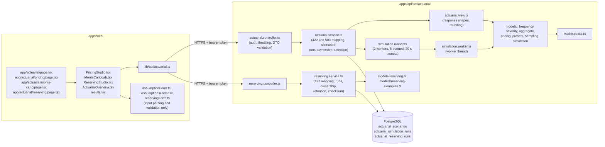

# Documentation historique — stack remplacée

> **État actuel :** l'application active est **Angular** (pps/web) + **Spring Boot** (pps/api) + **PostgreSQL**.
> NestJS / Next.js / React / Prisma Client ne font plus partie du runtime applicatif.
> Voir README.md, docs/architecture/LEGACY_CLEANUP_AUDIT.md et docs/ui/DESIGN_SYSTEM.md.
# Actuarial Lab: architecture

## 1. Principles

- **The server is the source of truth.** Every premium, probability and quantile is computed by the NestJS API. The browser validates inputs to give immediate feedback, then displays what the server returns. It never computes an actuarial figure itself.
- **Pure models, thin services.** The models are plain TypeScript functions with no I/O, so they can be unit-tested against hand calculations and reused by later phases (Monte Carlo, reserving, capital, ALM).
- **Explicit provenance.** Every response carries `provenance: { kind, basis, modelVersion, currency }`. The kind is `ESTIMATED` for model calculations and `SIMULATED` for Monte Carlo output, whose `basis` names the seed. Reserving responses carry `kind: MODEL_ESTIMATE` and a note that the figures are undiscounted best estimates, not regulatory technical provisions. The lab holds no observed claims data, so nothing is labelled observed. The reserving examples are fictional.
- **The event loop is never blocked.** Monte Carlo runs execute in worker threads with a bounded queue and a timeout. No separate service is involved.
- **Honest availability.** When a figure cannot be computed reliably, it is returned as `null` with a reason, never as zero. This covers, for example, the full loss distribution of a very large portfolio.
- **No LLM in any calculation.**

## 2. Layers



| Layer | Responsibility |
| --- | --- |
| `math/special.ts` | Log-gamma (Lanczos), log binomial coefficients, regularized incomplete gamma, normal CDF and quantile, generic CDF inversion |
| `models/frequency.ts` | Binomial and Poisson claim counts: moments, log-pmf, Panjer (a, b) parameters, count tables, quantiles |
| `models/severity.ts` | Deterministic, gamma and lognormal claim costs parameterised by mean and coefficient of variation: CDF, density, quantile, limited expected value; trend factor |
| `models/aggregate.ts` | Aggregate moments; exact lattice or Panjer distribution; VaR, TVaR, exceedance, histogram |
| `models/pricing.ts` | Premium build-up, gross-up for variable expenses and margin, ratios, probability of an underwriting loss, sensitivities |
| `models/presets.ts` | Model version, currency and three fictional example portfolios |
| `models/sampling.ts` | Exact Gamma, Beta, Binomial and Poisson samplers driven by the shared seeded generator `market-data/rng.ts` |
| `models/simulation.ts` | Run limits, the simulation loop, estimators with 95% intervals, histogram, exceedance curve, convergence trace, comparison with the exact model |
| `simulation.runner.ts` | Runs a simulation in a worker thread: at most 2 at once, 6 waiting, 30-second timeout that terminates the worker. Under ts-jest, where the compiled worker does not exist, it runs in-process |
| `simulation.worker.ts` | Worker-thread entry point: runs one simulation and posts the result back |
| `actuarial.view.ts` | Converts model results to JSON-safe response objects. Money is rounded to the millime with the shared `finance/money.ts` helpers; warnings are attached |
| `actuarial.service.ts` | Maps model errors to `422 INVALID_ASSUMPTIONS` or `422 SIMULATION_LIMIT` and runner errors to `503 SIMULATION_BUSY` or `503 SIMULATION_TIMEOUT`; whitelists inputs; caches presets; persists and reads scenarios and simulation runs |
| `actuarial.controller.ts` | Routes, Swagger documentation (tag *Actuarial Lab*), rate limits, UUID validation |
| `models/reserving.ts` | Triangle validation, link ratios, factor averages, CDFs, paid and incurred chain ladder, expected loss ratio, Bornhuetter–Ferguson, reserves, reconciliation, paid-against-incurred comparison, sensitivities, expected payments by calendar year, warnings. Pure functions, no I/O |
| `models/reserving-examples.ts` | Three fictional paid and incurred triangles with premiums: a short-tail motor book (2016–2025), a long-tail liability book with a paid tail (2016–2025) and a small book with a missing amount and a recovery (2020–2025) |
| `reserving.service.ts` | Maps model errors to `422 INVALID_TRIANGLE` or `422 FACTOR_UNDEFINED`; keeps only validated inputs; recomputes results before storing a run; per-user retention (25) under an advisory lock; SHA-256 data checksum; ownership filter on every read and delete |
| `reserving.controller.ts` | Routes under `/actuarial/reserving`, Swagger documentation, rate limits, UUID validation |
| `dto/reserving.dto.ts` | class-validator DTOs: triangle shapes, `null` cells, numeric ranges, label pattern |

## 3. Integration with the existing platform

| Concern | How it is reused |
| --- | --- |
| Authentication | The global JWT guard protects every `/api/actuarial/*` route. No route is public |
| Validation | The global `ValidationPipe` (whitelist, forbid unknown fields, transform) with class-validator DTOs |
| Errors | The platform's exception filter and error shape `{ statusCode, message, errorCode, details? }`. A missing table becomes `503 DATABASE_SCHEMA_OUTDATED` without leaking the table name |
| Money | `toAmount` and `fromAmount` from `apps/api/src/finance/money.ts` (integer millimes) |
| Rate limiting | `@nestjs/throttler`: 120 requests per minute per client, 60 for compute endpoints, 12 for `POST /simulations` |
| Random numbers | The seeded generator `market-data/rng.ts`, already used by the fictional market data. It is not used for security |
| Dashboard | `auth.service.ts` reports the `actuarial` module as available. The capability is derived, as for every module, from "permitted and available" |
| Navigation | `/actuarial` is `LIVE_INTEGRATED` in `workspaceNav.ts` (Insurance group) |
| UI | The existing workspace template: `PageHeading`, `Panel`, `KpiCard`, `EmptyState`, `PanelSkeleton`, global form and table classes, and the shared chart components. `ColumnChart` and chart markers were added to the shared `Charts.tsx` rather than introducing a chart library |

The Lab does not use the trading module or market prices; it only reuses the seeded generator from `market-data/rng.ts`, unchanged. The ALM Lab (Phase 4) will read the shared financial core for the insurer's asset side. It will not read users' trading portfolios.

## 4. Data flow in the Pricing Studio

1. On load, the studio fetches `GET /actuarial/presets` and fills the form with the reference portfolio.
2. Each edit is validated in the browser with the same bounds as the DTOs. Invalid fields show an inline message and nothing is sent.
3. A valid form is sent to `POST /actuarial/pricing/calculate` after a 350 ms pause. An `AbortController` cancels any request that is still running, so the screen always shows the result of the latest inputs.
4. While a request is running, the previous results stay visible and a polite live region announces the update.
5. **Save** sends the assumptions only. The server recomputes the results and stores them, so a client cannot store results that do not match its inputs.

**In the Monte Carlo Lab:**

1. The same assumption form (`AssumptionsForm.tsx`) is shown with the run settings: periods, seed, initial capital, optional premium charged and label. Settings are validated in the browser with the server's bounds.
2. **Run simulation** sends the assumptions and settings once. The page shows no results, and no placeholder figures, until the server answers with a completed run.
3. Editing any input after a run marks the displayed results as belonging to the previous inputs. They are not silently kept as if current.
4. **Load** in the run list restores the inputs, seed and settings of a stored run together with its stored results.

**In the Reserving Studio:**

1. On load, the studio fetches `GET /actuarial/reserving/examples` and fills the form with the motor example. Choosing another example replaces the data and assumptions.
2. Triangles are typed or pasted as text, one accident year per line (tabs, semicolons or spaces between amounts; `-` or `n/a` for a missing amount; thousands may be grouped). `reservingForm.ts` parses and checks the shape and ranges with the server's limits, and names the line and amount of any error. It computes nothing actuarial.
3. A valid form is sent to `POST /actuarial/reserving/analyze` after a 400 ms pause, with an `AbortController` cancelling the previous request. The previous results stay visible under a banner saying they were computed for earlier inputs, until the new ones arrive. A `422` from the server is shown with its message.
4. Selected factors are typed in the factor table; an empty field keeps the server's estimate. Every figure on the page, including the projected triangle, the link ratios and the sensitivities, comes from the response.
5. **Save run** sends the label and inputs; the server recomputes and stores. **Load** restores the inputs and displays the stored results ("Showing the stored results of …") until an input is edited. A run from an older model version is flagged.

## 5. Persistence

Saved scenarios and simulation runs are stored. Other calculations are stateless and are not logged.

```prisma
enum ActuarialScenarioKind { PRICING }

model ActuarialScenario {
  id           String                @id @default(uuid()) @db.Uuid
  userId       String                @map("user_id") @db.Uuid
  name         String                @db.VarChar(80)
  kind         ActuarialScenarioKind
  modelVersion String                @map("model_version") @db.VarChar(40)
  currency     String                @default("TND") @db.VarChar(3)
  inputs       Json
  results      Json
  createdAt    DateTime              @default(now()) @map("created_at")
  updatedAt    DateTime              @updatedAt @map("updated_at")

  user User @relation(fields: [userId], references: [id], onDelete: Cascade)

  @@unique([userId, name])
  @@index([userId, updatedAt])
  @@map("actuarial_scenarios")
}
```

**Rules:**

- **Ownership.** Every read and delete filters by `userId`. Another user's scenario is indistinguishable from a missing one: `404 SCENARIO_NOT_FOUND`.
- **Limit.** At most 50 scenarios per user. The count and insert run in one transaction under a per-user advisory lock (`pg_advisory_xact_lock`), so concurrent saves cannot exceed the limit.
- **Names.** Names are unique per user (`409 SCENARIO_NAME_TAKEN`).
- **Inputs.** The service copies only the fields the models read, so stored inputs never carry unvalidated extras.
- **Versioning.** `modelVersion` is stored with every scenario. When the model version changes, older scenarios are flagged `stale: true` instead of being silently recomputed.
- **Deletion.** Deleting a user deletes their scenarios (`ON DELETE CASCADE`).

`kind` is an enum so that later phases can add scenario kinds (reserving, capital, ALM) without a new table.

**Simulation runs:**

```prisma
model ActuarialSimulationRun {
  id            String   @id @default(uuid()) @db.Uuid
  userId        String   @map("user_id") @db.Uuid
  label         String?  @db.VarChar(80)
  engineVersion String   @map("engine_version") @db.VarChar(40)
  currency      String   @default("TND") @db.VarChar(3)
  seed          Int
  simulations   Int
  durationMs    Int      @map("duration_ms")
  inputs        Json
  results       Json
  createdAt     DateTime @default(now()) @map("created_at")

  user User @relation(fields: [userId], references: [id], onDelete: Cascade)

  @@index([userId, createdAt])
  @@map("actuarial_simulation_runs")
}
```

- **What is stored:** the validated inputs, the seed, the engine version, the run size and duration, the owner, and the summarised results (statistics, intervals, histogram counts, curves). **Individual simulated totals are never stored.** The size does not depend on the number of periods: on `PIF_test`, the results of 30 runs (2,000 to 20,000 periods) averaged 11 KB of JSON, at most 4.3 KB once compressed by PostgreSQL.
- **Reproducibility:** inputs + seed + engine version reproduce the stored results exactly. A run stored by another engine version is flagged `stale: true`.
- **Ownership:** every read and delete filters by `userId`; another user's run is `404 SIMULATION_NOT_FOUND`.
- **Retention:** the 25 most recent runs per user. The insert and the deletion of older runs happen in one transaction under a per-user advisory lock.
- **Database checks:** `seed ≥ 1`, `simulations` between 1,000 and 200,000, `duration_ms ≥ 0`.

**Reserving runs:**

```prisma
model ActuarialReservingRun {
  id            String   @id @default(uuid()) @db.Uuid
  userId        String   @map("user_id") @db.Uuid
  label         String   @db.VarChar(80)
  modelVersion  String   @map("model_version") @db.VarChar(40)
  currency      String   @default("TND") @db.VarChar(3)
  firstOrigin   Int      @map("first_origin")
  originCount   Int      @map("origin_count")
  valuationYear Int      @map("valuation_year")
  dataChecksum  String   @map("data_checksum") @db.Char(64)
  inputs        Json
  results       Json
  createdAt     DateTime @default(now()) @map("created_at")

  user User @relation(fields: [userId], references: [id], onDelete: Cascade)

  @@index([userId, createdAt])
  @@map("actuarial_reserving_runs")
}
```

- **What is stored:** the validated triangles, premiums and assumptions, the results recomputed by the server, the model version and a SHA-256 checksum of the data. Inputs and results of a 10-year example take 26 to 28 KB of JSON; the 6-year example, 18 KB.
- **Reproducibility:** inputs + model version reproduce the results exactly (the model is deterministic). A run stored by another model version is flagged `stale: true`.
- **Ownership:** every read and delete filters by `userId`; another user's run is `404 RESERVING_RUN_NOT_FOUND`.
- **Retention:** the 25 most recent runs per user, in one transaction under a per-user advisory lock.
- **Database checks:** `origin_count` 3 to 25, `first_origin` 1950 to 2100, `valuation_year = first_origin + origin_count − 1`, checksum of 64 lower-case hexadecimal characters.

## 6. Migration, backup and rollback

Migration: `apps/api/prisma/migrations/20261111090000_actuarial_scenarios/migration.sql`. It was generated with `prisma migrate diff` and reviewed by hand.

It is **purely additive**:

- one enum type;
- one table;
- two indexes;
- one foreign key to `users`.

It does not alter or rewrite any existing table.

| Database | Status (9 Nov 2026) |
| --- | --- |
| `PIF_test` | **Applied.** All 5 API e2e suites (40 tests) pass |
| `PIF` (development) | **Applied on 9 Nov 2026, with approval**, together with `20261110090000_virtual_trading`. A fresh backup was restore-tested first; existing row counts were unchanged afterwards. Log in [`docs/trading/database-migration.md` §5](../trading/database-migration.md#5-application-log) |

**Backup taken before applying to `PIF_test`:**

- File: `%LOCALAPPDATA%\PIF\db-backups\PIF_test-before-actuarial-20261109-170951.dump` (custom format, 70,227 bytes).
- Restore check: the dump was restored into a scratch database. Its row counts matched the source (instruments 7, applied migrations 5, users 0, portfolios 0). The scratch database was then dropped.

**Procedure used to apply it to `PIF`.** Run from `apps/api`; the connection string is read from `.env` and never printed:

1. Take a fresh `pg_dump -Fc` of `PIF` to `%LOCALAPPDATA%\PIF\db-backups`, and restore-test it as for the trading migration (see [`docs/trading/database-migration.md`](../trading/database-migration.md)).
2. Run `npx prisma migrate status`. Two migrations should be pending, `20261110090000_virtual_trading` and `20261111090000_actuarial_scenarios`.
3. Run `npx prisma migrate deploy`. It only applies pending migrations and never resets. Never run `prisma migrate reset` or `db push --force-reset` against `PIF`.
4. Verify: `GET /api/actuarial/overview` reports `scenarios.available: true`, and saving a scenario in the studio works.

**Rollback.** Preferred: restore the backup. Alternatively, remove only the new objects. Nothing else depends on them, but this deletes every saved scenario:

```sql
BEGIN;
DROP TABLE IF EXISTS "actuarial_scenarios";
DROP TYPE IF EXISTS "ActuarialScenarioKind";
DELETE FROM "_prisma_migrations" WHERE migration_name = '20261111090000_actuarial_scenarios';
COMMIT;
```

After a rollback, the current build keeps working:

- pricing still works;
- the overview reports that saved scenarios are unavailable;
- the scenario endpoints answer `503 DATABASE_SCHEMA_OUTDATED`.

### Simulation runs migration

Migration: `apps/api/prisma/migrations/20261112090000_actuarial_simulation_runs/migration.sql`, generated with `prisma migrate diff` and reviewed by hand. It is **purely additive**: one table with three CHECK constraints, one index and one foreign key to `users` (cascade on user deletion). It alters no existing table and creates no type.

| Database | Status (9 Nov 2026) |
| --- | --- |
| `PIF_test` | **Applied**, after the backup `PIF_test-before-simulation-runs-20261109-180601.dump` (77,396 bytes). All 6 API e2e suites (44 tests) pass |
| `PIF` (development) | **Applied on 9 Nov 2026 at 18:52, with explicit approval.** An earlier unapproved apply had been rolled back; see section 7 |

On a database without it, the current build:

- serves pricing and saved scenarios as before;
- reports in the overview that the simulation history is not enabled;
- answers `503 DATABASE_SCHEMA_OUTDATED` on `/simulations`. The Monte Carlo page explains this in plain English.

**How it was applied to `PIF`.** Run from `apps/api`; the connection string came from `.env` and was never printed. Each step stopped unless the target database was exactly `PIF`.

1. **Backup:** `%LOCALAPPDATA%\PIF\db-backups\PIF-before-simulation-runs-20261109-185210.dump` (105,217 bytes, `pg_dump -Fc`).
2. **Restore test:** the dump was restored into a scratch database, `pif_restore_check`. The row counts of all 23 tables were identical to the source; the scratch database was then dropped.
3. **Status:** `npx prisma migrate status` listed exactly one pending migration, `20261112090000_actuarial_simulation_runs`. The deploy was scripted to stop otherwise.
4. **Deploy:** `npx prisma migrate deploy` applied it. `migrate status` then reported "Database schema is up to date" (7 migrations).
5. **Verification (read-only):**
   - the 22 existing tables have the same row counts as in the backup (users 19, user_preferences 19, audit_events 169, auth_sessions 45, auth_tokens 152, instruments 7, all others 0);
   - `actuarial_simulation_runs` exists, is empty, and has its CHECK constraints and its foreign key to `users`;
   - `_prisma_migrations` holds 7 rows.

`GET /api/actuarial/overview` was not called against `PIF`, because that needs a signed-in account and testing there would mean creating one in the development database. The endpoints themselves are covered by the e2e tests on `PIF_test`, which has the same schema.

**Rollback.** Restore the backup, or remove only the new table. Nothing depends on it; this deletes every stored run:

```sql
BEGIN;
DROP TABLE IF EXISTS "actuarial_simulation_runs";
DELETE FROM "_prisma_migrations" WHERE migration_name = '20261112090000_actuarial_simulation_runs';
COMMIT;
```

### Reserving runs migration

Migration: `apps/api/prisma/migrations/20261114090000_actuarial_reserving_runs/migration.sql`, reviewed by hand. It is **purely additive**: one table with four CHECK constraints, one index and one foreign key to `users` (cascade on user deletion). It alters no existing table and creates no type.

| Database | Status (9 Nov 2026) |
| --- | --- |
| `PIF_test` | **Applied.** All 9 migrations; all 7 API e2e suites (48 tests) pass. No separate backup was taken first: `PIF_test` holds only disposable test data |
| `PIF` (development) | **Applied on 9 Nov 2026 at about 23:05, with explicit approval**, after a restore-tested backup (below) |

On a database without it, the current build:

- computes reserves as usual (`POST /reserving/analyze` and `GET /reserving/examples` need no table);
- reports in the overview that saved reserving runs are not enabled;
- answers `503 DATABASE_SCHEMA_OUTDATED` on `/reserving/runs`. The studio explains this in plain English and keeps calculating.

**How it was applied to `PIF`.** Run from `apps/api`; the connection string came from `.env` and was never printed. Each step stopped unless the target database was exactly `PIF`.

1. **Status:** `migrate status` listed exactly one pending migration, `20261114090000_actuarial_reserving_runs`. The script stopped otherwise.
2. **Fingerprint:** for each of the 24 tables, the row count and the md5 of all its rows (as text, sorted).
3. **Backup:** `%LOCALAPPDATA%\PIF\db-backups\PIF-before-reserving-runs-20261109-230407.dump` (109,528 bytes, `pg_dump -Fc`).
4. **Restore test:** the dump was restored into the scratch database `pif_restore_check`. All 24 fingerprints were identical to the source; the scratch database was then dropped.
5. **Deploy:** the fingerprint was taken again just before the deploy and was unchanged; `npx prisma migrate deploy` applied the migration.
6. **Verification (read-only):**
   - the only fingerprint differences are `_prisma_migrations` (8 to 9 rows) and the new, empty `actuarial_reserving_runs`. Every other table, including users 19, audit events 169, sessions 45 and tokens 152, has the same count and the same content hash;
   - `migrate status` reports "Database schema is up to date!" (9 migrations), and `migrate diff` against `schema.prisma` reports no difference;
   - the four CHECK constraints, the primary key and the foreign key to `users` exist and are validated, and the `(user_id, created_at)` index exists.

The reserving endpoints were not called against `PIF`, which would need a signed-in account in the development database. They are covered by the e2e tests and the browser journey on `PIF_test`, which has the same schema.

**Rollback.** Restore the backup, or remove only the new table. Nothing depends on it; this deletes every stored reserving run:

```sql
BEGIN;
DROP TABLE IF EXISTS "actuarial_reserving_runs";
DELETE FROM "_prisma_migrations" WHERE migration_name = '20261114090000_actuarial_reserving_runs';
COMMIT;
```

## 7. Incident: unapproved apply to `PIF` and rollback

**What happened (9 Nov 2026, about 18:06).** The simulation migration was meant to go to `PIF_test` only. The command built the `PIF_test` connection string into a shell variable that, in that invocation, was empty. `DATABASE_URL` was therefore unset, Prisma fell back to `apps/api/.env`, and `npx prisma migrate deploy` applied `20261112090000_actuarial_simulation_runs` to the development database `PIF`. Applying a migration to `PIF` requires explicit approval, which had not been given for this one.

**Impact.** The migration is additive. It created one empty table and one row in `_prisma_migrations`. No existing table or row was changed: the counts were checked straight away.

**Response:**

1. The apply was reported to the project owner, who chose to roll it back.
2. A fresh backup of `PIF` was taken first: `%LOCALAPPDATA%\PIF\db-backups\PIF-before-simulation-runs-rollback-20261109-181109.dump` (107,948 bytes). It was restore-tested into a scratch database (`pif_restore_check`), whose row counts matched the source; the scratch database was then dropped.
3. At about 18:11, the empty `actuarial_simulation_runs` table was dropped and its `_prisma_migrations` row deleted, as in the rollback SQL above. Nothing else was touched.

**State after the rollback** (re-checked read-only on 9 Nov 2026, after the Phase 2 regression, before the approved apply at 18:52):

| Check | `PIF` |
| --- | --- |
| Applied migrations | 6, the latest `20261111090000_actuarial_scenarios` |
| `actuarial_simulation_runs` | Absent |
| users / audit_events / auth_sessions / auth_tokens | 19 / 169 / 45 / 152, as before the incident |
| Tables in `public` | 23, as before the incident |

**Prevention.** Every database command run for this project now starts with a guard. It derives the `PIF_test` URL from `.env` and **stops before doing anything** unless the target database name is exactly `PIF_test`:

```powershell
$line = Select-String -Path .env -Pattern '^\s*DATABASE_URL\s*=' | Select-Object -First 1
$url = ($line.Line -split '=', 2)[1].Trim().Trim('"').Trim("'")
$db = ([Uri]$url).AbsolutePath.TrimStart('/')
$test = $url -replace ('/' + [Regex]::Escape($db) + '(\?|$)'), '/PIF_test$1'
if (-not $test -or ([Uri]$test).AbsolutePath.TrimStart('/') -ne 'PIF_test') { throw 'Refusing: target is not PIF_test' }
```

The connection string is never printed. The guard and the command it protects always run in the same shell invocation, because PowerShell variables do not persist between invocations, which is how the original variable came to be empty.

## 8. Frontend structure

| File | Role |
| --- | --- |
| `app/actuarial/page.tsx` | Overview route |
| `app/actuarial/pricing/page.tsx` | Claims & Pricing Studio route |
| `app/actuarial/monte-carlo/page.tsx` | Monte Carlo Lab route |
| `app/actuarial/reserving/page.tsx` | Reserving Studio route |
| `components/actuarial/parts.tsx` | Shell, workspace tabs (planned tabs are disabled and say "Planned"), estimate note, error messages, including the "migration not applied" case for scenarios, simulations and reserving runs |
| `components/actuarial/ActuarialOverview.tsx` | Reference KPIs, reference loss distribution, "What the numbers are", workspace cards linking to their pages, recent scenarios, recent simulations, recent reserving runs |
| `components/actuarial/ReservingStudio.tsx` | Example picker, triangle entry, assumptions, debounced server analysis, headline KPIs by method, data checks, triangle views (cumulative, incremental, link ratios, completed), factor table with selections, reserves by accident year, method comparison, paid against incurred, development curves, sensitivities, expected payments, run list (save, load, delete), definitions and formulas |
| `components/actuarial/reservingForm.ts` | Triangle text parsing (tabs, semicolons or spaces; `-` for missing), form validation with the server's limits, request building. No actuarial calculation |
| `components/actuarial/AssumptionsForm.tsx` | The portfolio assumption form, shared by the studio and the Monte Carlo Lab |
| `components/actuarial/PricingStudio.tsx` | Presets, assumption form, debounced server pricing, scenario save, load and delete |
| `components/actuarial/MonteCarloLab.tsx` | Run settings, run status, simulated KPIs, distribution, thresholds, simulated-against-exact tables, exceedance and convergence charts, run list (load, delete), method notes |
| `components/actuarial/results.tsx` | Premium KPIs, premium build-up, aggregate distribution, frequency, severity, sensitivity and formula panels |
| `components/actuarial/assumptionForm.ts` | Form state (rates in percent), conversion to API assumptions, validation mirroring the DTOs, run-settings validation, seed generation (`crypto.getRandomValues`) |
| `components/actuarial/format.ts` | TND, whole-dinar, ratio, probability and count formatting |
| `components/actuarial/actuarial.module.css` | Layout only. Colours, radii and typography come from the template tokens |
| `components/charts/Charts.tsx` | Shared charts. Phase 1 added `ColumnChart`, markers and an optional `yMin` floor for `LineChart`. The Monte Carlo Lab reuses them |

**Responsive layout.** At 1440 px, the studio and the Monte Carlo Lab show the form beside the results. From 1100 px down, they use one column. Rows of KPI cards go from five columns to three, two and one. Interval hints under table values wrap at the dash, never inside an amount, so the comparison tables fit the panel at desktop width. Narrower screens scroll the tables inside the template's table wrapper.

**Accessibility:**

- Every input has a label.
- Toggles expose `aria-pressed`.
- The calculation status is a polite live region.
- Tables have captions.
- Charts have a text description.
- Disabled tabs use `aria-disabled`.

**Reserving triangle.** The triangle table scrolls inside its panel; the accident-year column stays in place. Latest-diagonal amounts are bold, projected amounts are italic on a shaded background, and missing amounts are an amber dash with the tooltip "Missing amount". A note under the table explains the bold, the shading and the dash, so the meaning does not rely on colour alone. Below 480 px, the segmented controls take the full width and wrap to two columns.

## 9. The ALM interface

The Reserving Studio is the liability side of the planned ALM Lab. The interface is `results.cashFlows`:

| Field | Meaning |
| --- | --- |
| `basis` | `CHAIN_LADDER_PAID`: expected payments from the projected paid triangle |
| `valuationYear` | Payments are dated by calendar year after this year |
| `periods[]` | `{ calendarYear, expectedPayment }` for years \(v+1\) to \(v+n-1\) |
| `afterLastDevelopmentYear` | Paid-tail payments with no timing; the ALM Lab must assign a pattern to them explicitly |
| `total` | Equals the paid chain-ladder unpaid |
| `discounting` | `NONE`. Discounting belongs to the ALM Lab, with its own yield curve |

**Separation kept for later phases:**

- **Liabilities** (this phase): undiscounted best-estimate claim payments, with no risk margin and no expenses.
- **Investments**: the ALM Lab will read the shared financial core for the insurer's asset side. It will not read users' trading portfolios.
- **Capital**: economic capital will be a separate, explicitly internal model. Nothing in the lab is a regulatory solvency figure.
- **Regulatory versus internal**: the reserves here are internal best estimates for learning; they are not regulatory technical provisions.

The intended design is for the ALM Lab to read a stored reserving run by id (its inputs, model version and checksum make it reproducible) rather than recompute live. Nothing in the ALM Lab exists yet.
