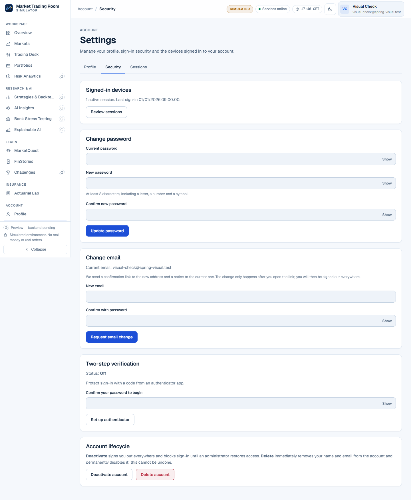
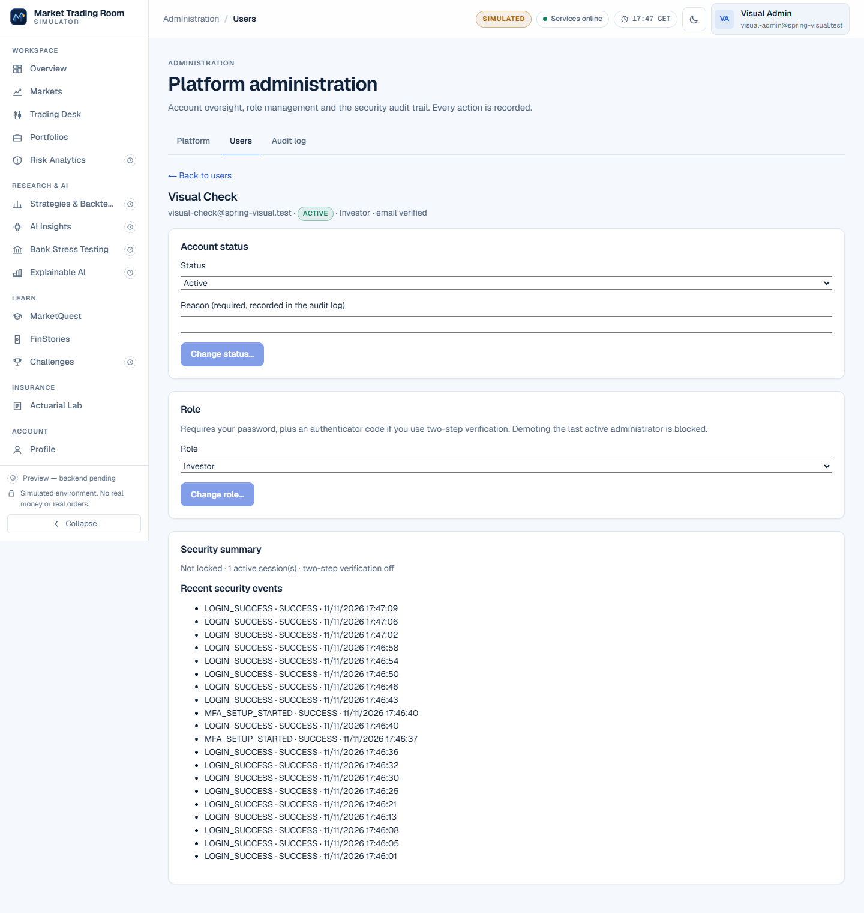

# UI and visual parity

## How the design is preserved

- **Design tokens and global styles:** `apps/web/src/app/globals.css` is copied verbatim to `apps/web-angular/src/styles/globals.css`. No Angular Material or other component library is used.
- **Component styles:** each CSS module is copied verbatim into the matching component stylesheet, with the same class names, and Angular's emulated encapsulation replaces CSS-module hashing. Every component host uses `display: contents`, so the DOM boxes match the React tree and parent selectors keep working. Icons and the brand emblem are attribute components on `<svg>` for the same reason. Navigation groups are rendered from a template inside the shell, because a separate component would break ancestor selectors such as `.shell[data-collapsed='true'] .sidebar .groupLabel`.
- **Fonts:** Geist and Geist Mono variable fonts from `@fontsource-variable/*` 5.3.0, exposed through the same `--font-geist-sans` / `--font-geist-mono` variables as `next/font`. Since Phase 2, `apps/web-angular/src/styles.css` also declares the same metric-adjusted fallback faces that `next/font` generates (`Geist Fallback` and `Geist Mono Fallback`: `local("Arial")` with the same ascent, descent, line-gap and size-adjust overrides). This matters beyond font loading: characters Geist does not contain, such as the `←` in "← Back to users", are drawn from the fallback face, and they now render identically. The only remaining difference from `next/font` is that the files are bundled instead of served from `/_next/static/media`.
- **Document head:** same title, description, `application-name`, `theme-color` metas, `icon.svg`, and the same inline theme bootstrap script (`mtrs-theme` key, no flash of the wrong theme).
- **Text:** all copy is ported verbatim, in English.

## Pixel comparison

Tool: `scripts/migration/visual-parity.mjs`. It runs headless Microsoft Edge with `deviceScaleFactor: 1`, reduced motion, and a fresh profile. Each scenario is driven identically in Next.js (3000, NestJS) and Angular (4200, Spring), with the same disposable accounts on `PIF_spring_test` (the script refuses any database whose name does not end in `_test`). Full-page captures are compared pixel by pixel. A pixel "differs" when a colour channel differs by more than 32/255; the exact count of pixels differing at all is also recorded. Only the dev-only Next.js overlay (`nextjs-portal`) and the text caret are hidden.

### Keeping the data identical without hiding real differences

Both apps read the same database, but a run changes it: every sign-in adds a session and an audit event. Three measures keep the compared data equal. None of them changes markup or styles.

- **Session reset:** before the Security and Sessions scenarios, the visual account's live sessions are revoked in `PIF_spring_test`, so each app starts from exactly one session.
- **Timestamp pinning:** on the Security page, the "Last sign-in …" time inside the session summary is replaced with a fixed value in both apps after rendering. It is the time of the sign-in the scenario itself just performed, so it always differs by a few seconds.
- **API replay (admin scenarios only):** at the network layer, the browser records the bodies of the NestJS `/api/admin/*` responses during the Next.js capture. During the Angular capture, it serves those bodies in place of Spring's, keeping Spring's status code and headers. A body is replayed only when the status codes match; otherwise the mismatch is recorded in the report and Spring's own response is kept. In the final run, 7 bodies were replayed and there were **0 status mismatches**. Response-shape equality itself is verified separately by the differential contract suite (216/216, see [API_PARITY_MATRIX.md](API_PARITY_MATRIX.md)). Replay therefore isolates rendering from data that legitimately changes between captures, such as audit counts.

### Final run

**2026-11-11 16:48 UTC: 97 comparisons, 0 failures, 0 page errors.** All 97 pairs have identical page sizes, and neither app overflows horizontally at any width. **65** comparisons have no pixel beyond tolerance. The other **32** have at most **0.113%** of pixels beyond tolerance, with the causes explained below.

| Scenario | Theme | Widths | Pixels beyond tolerance | Pixels differing at all | Max channel delta |
| --- | --- | --- | --- | --- | --- |
| `login` | light | 1440 / 768 / 375 | 0% / 0% / 0% | 60 / 42 / 36 | 16 / 7 / 7 |
| `login` | dark | 1440 / 768 / 375 | 0% / 0% / 0% | 60 / 42 / 36 | 29 / 29 / 29 |
| `login-validation` (empty submit) | light | 1440 / 375 | 0% / 0% | 60 / 36 | 16 / 7 |
| `login-error` (unknown account) | light | 1440 / 375 | 0% / 0% | 62 / 38 | 16 / 7 |
| `login-mfa` | light | 1440 / 768 / 375 | 0% / 0% / 0% | 50 / 32 / 29 | 16 / 6 / 7 |
| `settings-profile` (shell + form) | light | 1440 / 768 / 375 | 0% / 0% / 0% | 124 / 66 / 71 | 7 / 5 / 5 |
| `settings-profile` | dark | 1440 / 768 / 375 | 0% / 0% / 0% | 121 / 66 / 66 | 21 / 14 / 14 |
| `shell-collapsed` | light | 1440 | 0% | 73 | 7 |
| `profile-menu` (open) | light | 1440 | 0% | 122 | 7 |
| `mobile-drawer` (open) | light | 375 | 0% | 46 | 5 |
| `register` | light | 1440 / 768 / 375 | 0% / 0% / 0% | 70 / 52 / 45 | 16 / 6 / 7 |
| `register` | dark | 1440 / 768 / 375 | 0% / 0% / 0% | 71 / 53 / 46 | 20 / 15 / 15 |
| `register-validation` (empty submit) | light | 1440 / 375 | 0% / 0% | 70 / 45 | 16 / 7 |
| `register-password-strength` | light | 1440 | 0% | 71 | 16 |
| `forgot-password` | light | 1440 / 768 / 375 | 0% / 0% / 0% | 59 / 41 / 34 | 16 / 6 / 7 |
| `forgot-password` | dark | 1440 / 768 / 375 | 0% / 0% / 0% | 59 / 41 / 34 | 20 / 12 / 12 |
| `forgot-password-sent` | light | 1440 / 375 | 0% / 0% | 61 / 36 | 16 / 7 |
| `resend-verification` | light | 1440 / 768 / 375 | 0% / 0% / 0% | 59 / 41 / 35 | 16 / 6 / 7 |
| `verify-email-link` (confirmation step, token removed from the URL) | light | 1440 / 768 / 375 | 0% / 0% / 0% | 83 / 65 / 60 | 16 / 7 / 7 |
| `verify-email-missing-token` | light | 1440 / 375 | 0% / 0% | 74 / 53 | 16 / 7 |
| `reset-password-handoff` | light | 1440 / 768 / 375 | 0% / 0% / 0% | 78 / 60 / 57 | 16 / 6 / 7 |
| `reset-password-form` | light | 1440 / 375 | 0% / 0% | 60 / 37 | 16 / 7 |
| `confirm-email-change-link` | light | 1440 / 768 / 375 | 0% / 0% / 0% | 68 / 50 / 42 | 16 / 6 / 7 |
| `unauthorized` | light | 1440 / 768 / 375 | 0% / 0% / 0% | 27 / 27 / 27 | 6 / 6 / 6 |
| `admin-forbidden-investor` (investor opens `/admin`) | light | 1440 / 375 | 0% / 0% | 27 / 27 | 6 / 6 |
| `settings-security` | light | 1440 / 768 / 375 | 0.003% / 0.001% / 0.006% | 463 / 456 / 331 | 60 / 48 / 58 |
| `settings-security` | dark | 1440 / 768 / 375 | 0.004% / 0.001% / 0.008% | 461 / 454 / 326 | 48 / 46 / 48 |
| `security-password-validation` | light | 1440 / 375 | 0.003% / 0.006% | 463 / 335 | 60 / 58 |
| `security-mfa-enrolment` (secret step; the disposable secret is masked before capture) | light | 1440 / 375 | 0.003% / 0.006% | 487 / 359 | 60 / 58 |
| `security-delete-dialog` | light | 1440 / 375 | 0.001% / 0.003% | 794 / 281 | 52 / 52 |
| `settings-sessions` | light | 1440 / 768 / 375 | 0% / 0% / 0% | 102 / 45 / 54 | 7 / 5 / 5 |
| `settings-sessions` | dark | 1440 / 768 / 375 | 0.016% / 0.02% / 0.052% | 413 / 293 / 298 | 161 / 161 / 161 |
| `sessions-sign-out-everywhere-dialog` | light | 1440 / 375 | 0% / 0% | 235 / 103 | 4 / 4 |
| `admin-overview` | light | 1440 / 768 / 375 | 0.071% / 0.067% / 0.063% | 3560 / 1699 / 2096 | 76 / 76 / 76 |
| `admin-overview` | dark | 1440 / 768 / 375 | 0.059% / 0.06% / 0.057% | 3018 / 1721 / 1715 | 93 / 86 / 86 |
| `admin-users` | light | 1440 / 768 / 375 | 0.03% / 0.035% / 0.049% | 1331 / 1119 / 1084 | 79 / 79 / 79 |
| `admin-user-detail` | light | 1440 / 768 / 375 | 0.104% / 0.113% / 0.024% | 6464 / 3063 / 1474 | 79 / 79 / 57 |
| `admin-role-dialog` | light | 1440 / 375 | 0.103% / 0.024% | 6654 / 1470 | 79 / 57 |
| `admin-audit` | light | 1440 / 768 / 375 | 0.003% / 0.003% / 0.004% | 1018 / 601 / 184 | 76 / 56 / 76 |

### Residual differences, explained

Every residual area was inspected in the saved captures and diff images.

1. **Live session times crossing a minute (3 comparisons, `settings-sessions` dark):** the session list shows sign-in times to the minute. Next.js was captured at 17:46 and Angular at 17:47. This is a data difference, not a rendering one: the same light-theme scenario a minute earlier differs by at most 7/255.
2. **Sub-pixel glyph positioning on lines built from interpolated data (29 comparisons: the Security scenarios and all admin scenarios):** zoomed side by side, the text, glyphs, line boxes and page sizes are identical. The differences are anti-aliasing on thin stems (mostly the digit `1`, plus a few letters), shifted by a fraction of a pixel along lines such as `LOGIN_SUCCESS · SUCCESS · 11/11/2026 17:27:54` and `Current email: visual-check@…`. The likely cause, not yet proven, is DOM structure. React emits a separate text node for each `{expression}`, while Angular emits one interpolated text node, so Chromium may round glyph advances differently. Static screens show none of this.
3. **The shell clock chip** shows the current minute and can tick between the two captures. In the final run it did not; in the previous run it caused the 166/255 peak on `admin-overview`.

Changes since the previous run that removed real differences: the `next/font`-equivalent fallback faces fixed the "← Back to users" arrow (previously 216/255), and the Security-page timestamp pin now also matches Angular's combined "1 active session. Last sign-in …" text (previously 176/255).

Files in [screenshots/](screenshots/): `<scenario>-<theme>-<width>-next.png`, `-angular.png`, `-diff.png` (red = differing pixel), and `visual-parity-report.json` (including `replayedApiBodies` and `replayMismatches` per comparison). Journey screenshots of the Angular app are in [screenshots/journey/](screenshots/journey/).

### Samples (Angular, 1440 px)

## Notes and limits

- Dates use the browser locale in both apps (French in the test browser). The behaviour is identical, not a difference.
- Screens not yet migrated have no comparison. The Angular app shows a plain "not migrated yet" notice for them.
- Only Microsoft Edge (Chromium) was used. Firefox and Safari rendering has not been compared.
- Each full run signs the visual accounts in about 14 times per API. The per-account sign-in limit is 20 per 15 minutes, so back-to-back runs must be at least 15 minutes apart (see the incident in [TEST_REPORT.md](TEST_REPORT.md)).
