# Transactional email test report

Date: 2026-10-16. Environment: Windows, Node 22, PostgreSQL 18 (dev database `PIF`, test database `PIF_test`), API on :3001 in `MAIL_TRANSPORT=preview`, Next.js dev on :3000, preview inbox on 127.0.0.1:3025, headless Microsoft Edge driven over the DevTools protocol. No Docker.

## Delivery states (never conflated)

| State | Meaning | Status in this environment |
|---|---|---|
| **RENDERED** | template produced subject, preheader, HTML and text | VERIFIED (unit tests, every template) |
| **CAPTURED** | full RFC 5322 message written to the local preview folder by the real flow; nothing sent | VERIFIED (real registrations, resets, MFA, email change) |
| **SMTP-ACCEPTED** | a real relay accepted the message | NOT VERIFIED: no relay credentials configured |
| **DELIVERED** | message observed in a real recipient inbox with SPF/DKIM/DMARC results | NOT VERIFIED |

**REAL INBOX DELIVERY: BLOCKED—SMTP CREDENTIALS / VERIFIED SENDER NEEDED.** The code path is in place and unit-tested with a mocked transport (TLS, retries, acceptance vs failure). `npm run mail:verify` against the configured `localhost:1025` fails honestly with `ESOCKET`.

## Results

| Layer | Command | Result |
|---|---|---|
| Typecheck + lint (API, web) | `npm run verify` | pass, 0 warnings |
| API unit tests | `npm run verify` | **325 / 325** (19 suites), including the new suites below |
| Web unit/DOM tests | `npm run verify` | **95 / 95** |
| DB integration on `PIF_test` | `npm run test:e2e -w @mtrs/api` | **14 / 14** (identity suite + new email suite) |
| Browser E2E (Edge) | `npm run test:e2e:email` | **49 / 49** checks |
| Production builds | `npm run build:api`, `npm run build:web` | both succeed |

### New and changed automated tests

- `email.templates.spec.ts` (A, templates). Every template has a subject without line breaks, a preheader, HTML and text. Also checked: the dark palette, 600px container, 12px radius and system fonts; no `<script>`, ``, `<link>`, forms, `@import` or remote `src`; a hidden preheader before the H1; at most one primary CTA; no third-party branding; token URL only in the button and fallback (three times in HTML, once in text); expiry only on token links; reset vs change wording; the old-address guidance; reactivation wording for unverified accounts; MFA mails state codes are never emailed; HTML escaping of names and addresses. The original assertions are kept.
- `mail-transport.spec.ts` (A/B, transport):
  - the preview writes `.eml`, `.html`, `.txt` and `.json`, and the `.eml` has CRLF `From`/`To`/`Subject`/`Message-ID`/`Date` headers and is `multipart/alternative`;
  - pruning keeps the newest messages, and path-like ids are rejected;
  - transient vs permanent SMTP error classification;
  - STARTTLS is required with TLS 1.2 or newer;
  - retries 4xx/timeouts with bounded backoff, gives up after 3 attempts, never retries `EAUTH`/5xx, and treats all-recipients-rejected as a failure.
- `email.service.spec.ts` (B, service): the canonical frontend link is URL-encoded; logs contain neither the raw token nor the full recipient (masked `ad***@`); preview is refused in production; delivery failure returns `false` and redacts addresses in the error.
- `env.validation.spec.ts` (B, configuration):
  - production rejects `MAIL_TRANSPORT=preview`, a loopback relay by name or IP, `@localhost` and `example.*` senders, plaintext SMTP, and a user without a password;
  - preview is accepted outside production, and unknown transports are rejected.
- `auth.service.spec.ts` (B, service): the welcome email is sent only when verification activates the account (not for a suspended account, and not on an invalid token).
- `test/email-flows.e2e-spec.ts` (C, PostgreSQL `PIF_test`):
  - registration link verifies in the DB exactly once;
  - the stored token is a 64-hex HMAC, never the raw value;
  - login returns 403 `EMAIL_NOT_VERIFIED` before verification and 200 after;
  - reuse returns 400 `TOKEN_INVALID`;
  - 6 concurrent confirmations produce exactly one 200;
  - resend cooldown, with an identical response for unknown addresses;
  - a newer link supersedes an older one;
  - reset works once, revokes every session, rejects the old password and sends the completion notice;
  - unknown forgot-password sends nothing;
  - expired links are rejected;
  - no raw token in responses or audit rows.
- `test/auth.e2e-spec.ts`: this suite had never run before, because no `_test` database existed. Its refresh test assumed a refreshed JWT always differs, but login and refresh within the same second sign identical claims, since `iat` has one-second resolution. The test now waits 1.1 s; the assertion is unchanged.
- `test/e2e-database-guard.ts`: DB suites are now forced into preview mode in a temp folder, so tests can never send real mail or pollute the developer inbox.
- `scripts/e2e/email-flows.mjs` (D, browser): 49 checks through the real UI with throwaway `@example.test` accounts and random passwords that are never printed (list below).

### Browser E2E checks (latest run: 49 / 49 PASS)

1. `/verify-email`, `/reset-password` and `/confirm-email-change` send `Referrer-Policy: no-referrer` and `Cache-Control: no-store`.
2. Register form shows the generic confirmation. The verification email is captured from that real registration as RFC 5322 multipart/alternative, with 60-minute single-use copy, the first-name greeting, no third-party branding, and a link to `APP_FRONTEND_URL/verify-email`.
3. A real mouse click on the CTA inside the preview inbox opens `/verify-email` in a new tab.
4. A scanner-style GET of the link returns 200 and does not verify (login still `EMAIL_NOT_VERIFIED`).
5. The login page explains `EMAIL_NOT_VERIFIED` and offers resend.
6. The token is removed from the address bar on load. Confirm POST verifies, the welcome email is sent, reuse is rejected, and login lands on `/dashboard`.
7. Resend inside the cooldown sends nothing; known and unknown addresses get the same response; 5 concurrent confirmations produce exactly one success.
8. Forgot password (UI) is generic for unknown addresses; the reset email states 30 minutes; the reset page strips the token; reset completes once; the completion email says every device was signed out; reuse returns `TOKEN_INVALID`; the old password fails and the new one works.
9. MFA enable (real TOTP), recovery-code regeneration and disable each send a notice, and none contains the secret or any recovery code. Disabling MFA invalidates the old access token.
10. A signed-in password change sends the "other devices" wording.
11. Email change:
    - the request is generic, and the old address gets a masked alert;
    - the link GET returns 200 without consuming the token;
    - the page strips the token, and Confirm POST moves the account;
    - both addresses get completion notices, and the old-address notice explains that reset links now go to the new address;
    - sign-in works only with the new address.
12. No uncaught page errors.

## Manual acceptance (E)

One throwaway account, `mail-demo-20261016010745@example.test`, was registered through `POST /api/auth/register`:

1. The API log showed `Email captured to local preview (not delivered): template=verify-email to=ma***@example.test`.
2. The `.eml` headers are `From: Market Trading Room Simulator <noreply@localhost>`, `Subject: Verify your email for MTRS` and `multipart/alternative`.
3. Before verification, PostgreSQL `PIF` had `{"emailVerified":false,"status":"PENDING_VERIFICATION"}`.
4. The link was opened in Edge. The token was stripped from the address bar after hydration, Confirm was clicked, and the page showed "Email verified successfully. You can now sign in."
5. After verification, `PIF` had `{"emailVerified":true,"emailVerifiedAt":"2026-10-16T00:19:34.429Z","status":"ACTIVE"}`.
6. Forgot-password sent `Reset your MTRS password`, the reset succeeded, and sign-in returned 200 with an access token. The account's inbox then held verify-email, welcome, reset-password and password-changed.

Preview inbox access controls, probed over HTTP:

- it listens on `127.0.0.1` only;
- a foreign `Host` header returns 403, a traversal id returns 404, and `POST` returns 405;
- message HTML is served with `sandbox` CSP, `no-referrer` and `no-store`.

## Real SMTP (F)

**BLOCKED—SMTP CREDENTIALS / VERIFIED SENDER NEEDED.** To unblock: put provider SMTP values in `apps/api/.env` (see [setup](transactional-email-setup.md#2-real-smtp-delivery)), run `npm run mail:verify -- --to <your inbox>`, and confirm arrival and `spf=pass dkim=pass dmarc=pass` in the received headers.

## Final gates

| Gate | Result |
|---|---|
| Verification email from a real registration | PASS (CAPTURED) |
| Preview works without Docker | PASS |
| Email URL is not a 404 | PASS (200) |
| GET does not consume the token | PASS |
| Confirm updates PostgreSQL | PASS (`PIF` and `PIF_test`) |
| Login blocked before verification, works after | PASS |
| Resend cooldown | PASS |
| Reset works once | PASS |
| No reuse, no races | PASS (5–6 parallel requests, exactly one success) |
| Password-changed email | PASS (reset and change wording) |
| Email-change safety | PASS (link to new, alert to old, notices to both, GET-safe) |
| MFA emails without secrets | PASS |
| Coherent dark MTRS design | PASS (screenshots below) |
| SMTP working or honestly blocked | BLOCKED, honestly reported |
| No third-party (TaxGain) branding | PASS (unit + E2E assertions) |
| Existing security intact | PASS. Password policy, roles, deletion semantics, MFA and CSRF are unchanged; the full existing test suite still passes. |
| Tests, lint, typecheck and builds actually run | PASS (numbers above) |

## Screenshots

Captured by the E2E run. Token values are redacted on screen before capture, and the links shown were consumed during the run.

| | |
|---|---|
| Preview inbox 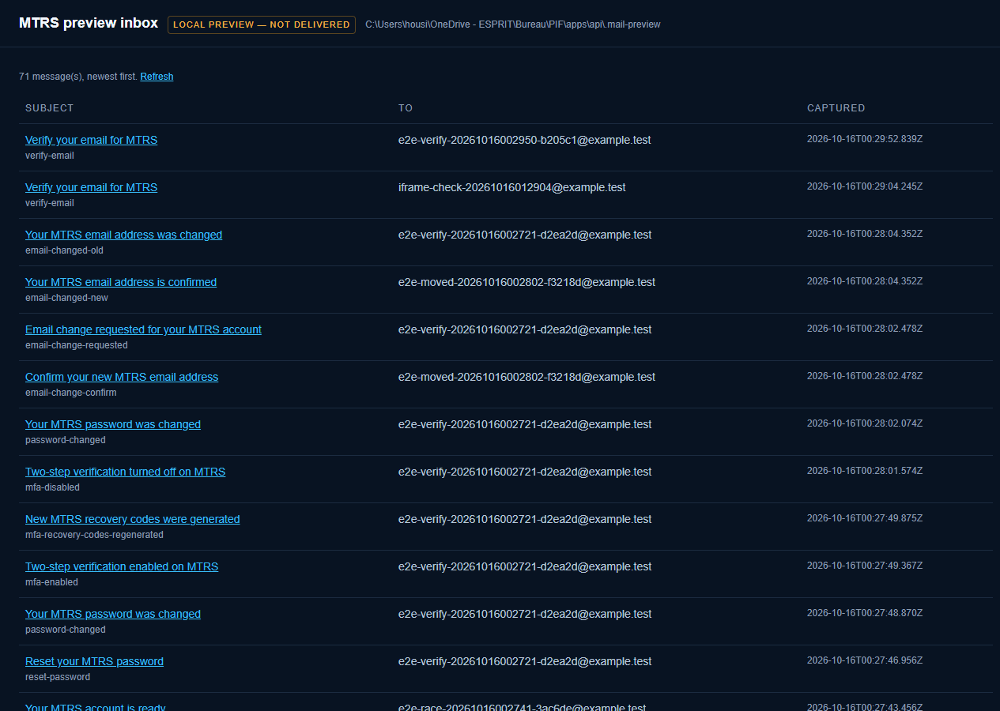 | Verification email, desktop 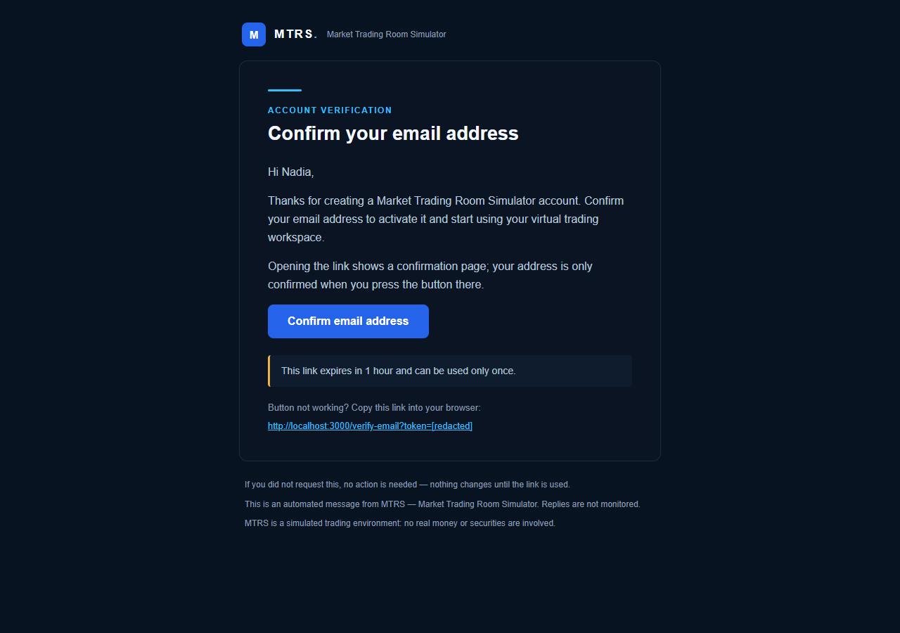 |
| Verification email, 390px 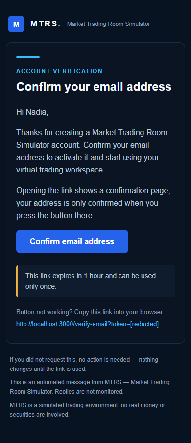 | `/verify-email` before Confirm  |
| After Confirm 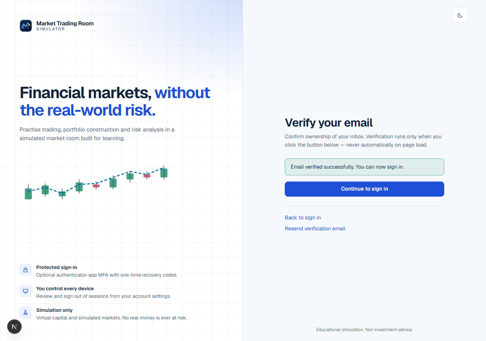 | Reset email 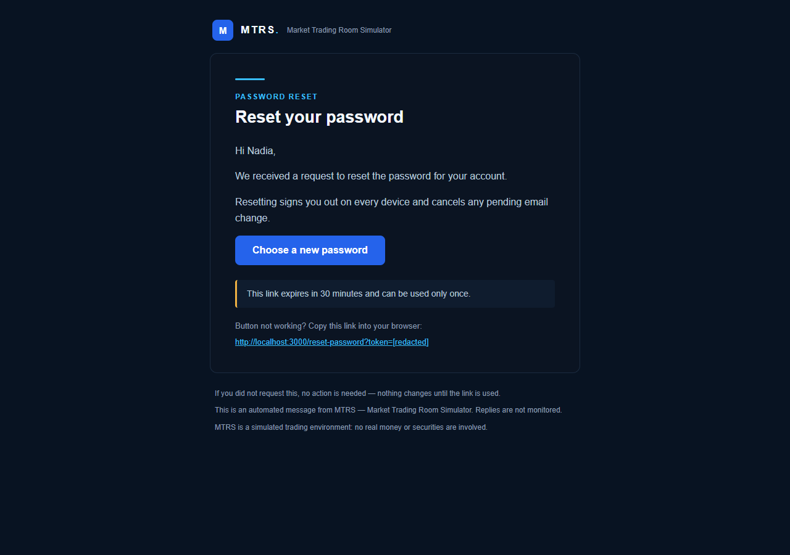 |
| Password changed 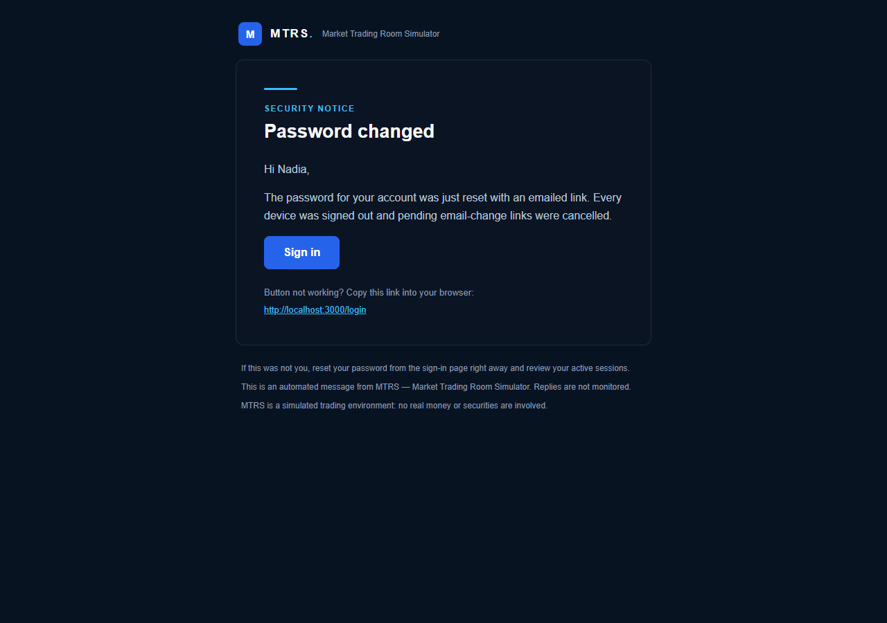 | Email change confirm 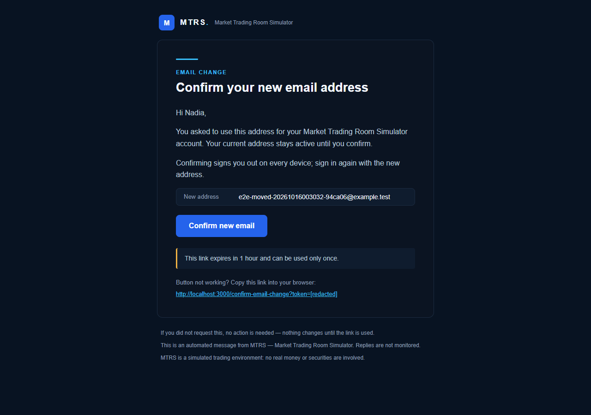 |
| Old-address notice 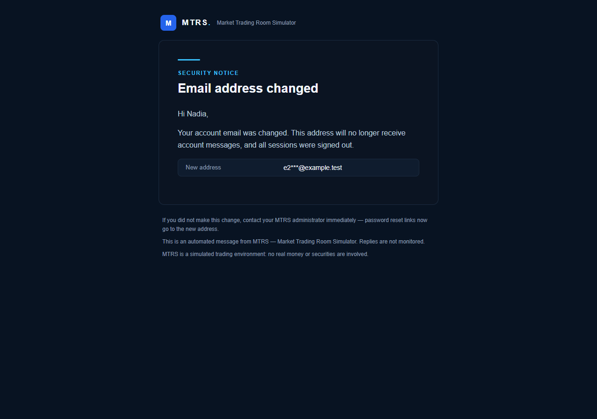 | MFA enabled 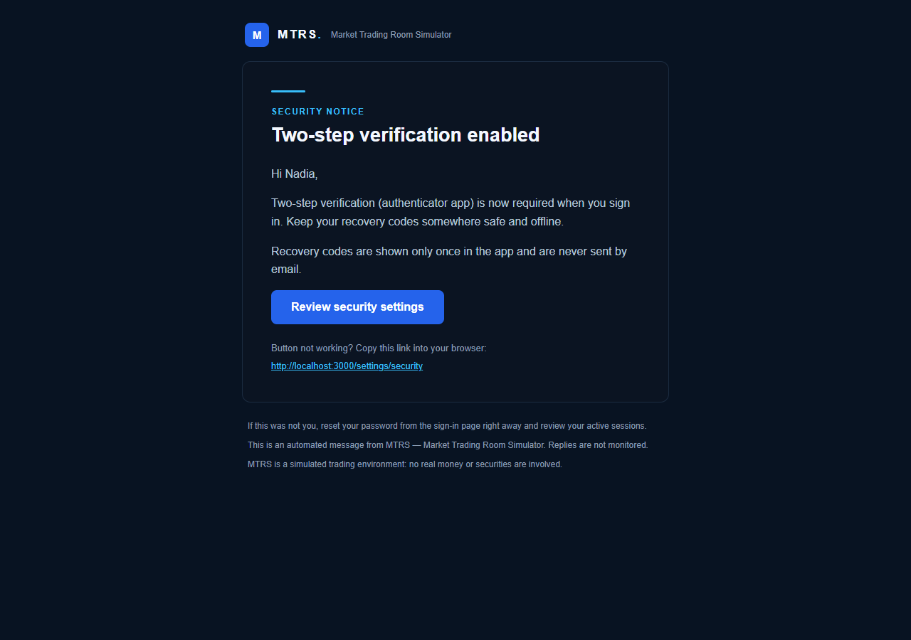 |
| Welcome 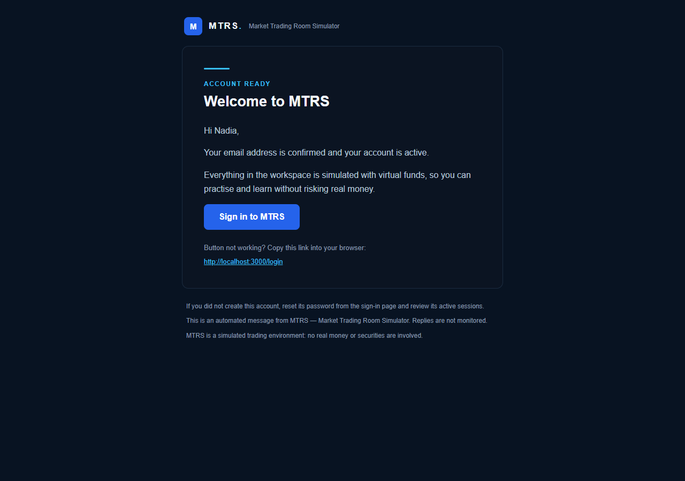 | Manual acceptance result 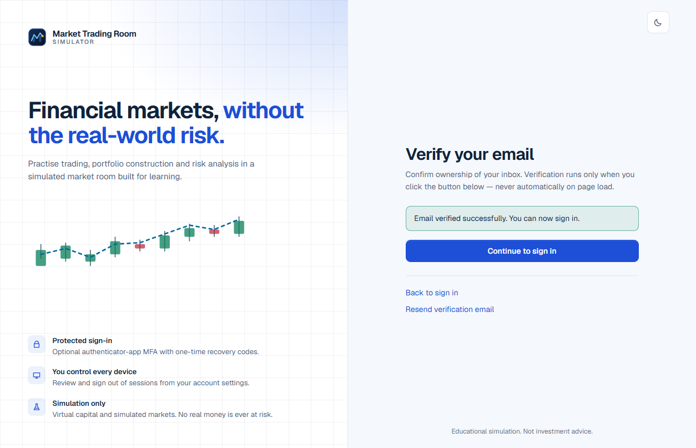 |

## Known limits and follow-ups

- Sends are fire-and-forget with in-process retries, and there is no durable outbox. A relay outage longer than about 5 seconds loses that message (users can resend or request again).
- The `notifyEmailSecurity` preference is stored but not consulted by security notices. Security mail is always sent, which is the safer default; making it configurable is a product decision.
- Clients that force light mode may invert the dark design. The layout stays readable because colours are set on tables with `bgcolor` fallbacks, but this was not tested in real clients (Gmail, Outlook) since no real delivery was possible.
- Throwaway `@example.test` accounts created by these runs remain in the dev database `PIF` (none hold real data).
